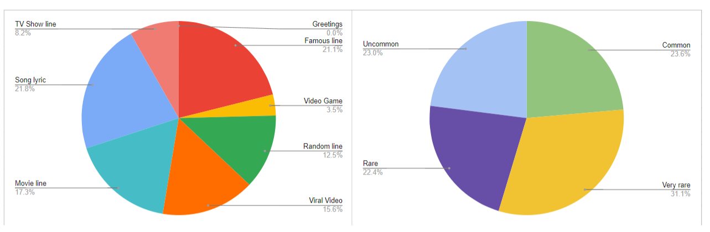

# Internet Anthropology: An Investigation into Twitch's Forsen and His Community

## Disclaimer
* This project has not been touched since approximately November of 2023; the repo was uploaded in its entirely in September of 2026 with minimal edits.
* Some of the content herein may be deemed insensitive. Individual discretion advised.

## Abstract
The present article is an anthropological investigation and writeup of the popular Internet streamer, Sebastian Fors, also known as Forsen. Forsen has a dedicated following of particularly humorous young men, called the Forsen Bajs (from Swedish for "Boys"), who constitute a unique Internet civilization unto itself. Ironic to the end, always criticizing, patently irreverent, infinitely aware of their own unique flavor of hyperniche Internet humor deterring newcomers (and fond of gaslighting newcomers for it), Forsen's community, the Forsen Bajs, presents, perhaps, the most striking example of a fully-developed, complex Internet civilization, with its own language, customs, culture and history, akin to the chaotic culture of 4chan, but with greater depth, inasmuch as the Bajs are centered around a real figurehead, Forsen himself. Future historians of the Internet will undoubtedly marvel at the anthropological enigma of Forsen and his Bajs, who have collectively altered the course of live viewership platforms to no small degree. 

### Keywords
internet anthropology, digital culture, twitch, forsen

## Introduction
See Forsen's [Wikipedia page](https://en.wikipedia.org/wiki/Forsen) for more personal information. The present article intends to deconstruct and delineate the Internet microcosm surrounding the Swedish content creator, Sebastian Fors, referred to more commonly by his gamertag, *forsen*. Some of the anthropological analysis of Forsen's community stems from, and delves into, Forsen's personal life, but this is not the focus of the present article.

* **Name:** Hans Eli Sebastian Fors
* **Born:** December 16, 1990
* **Birthplace:** Umeå, Sweden
* **Gamertags:** forsen, forsenlol, JustGetAHouse

### Conventions and Adherences
Following are the prescriptions followed throughout this article.

* Forsen will be referred to as "Forsen"
* Forsen's community will be referred to as "chat" or "Bajs" interchangeably

### Disclaimer
Some of what is reported in the present article may offend particular parties, e.g., as many of the Bajs' jokes are race-related or possibly insensitive of certain historical periods. It is not the purview of this article to provide commentary on the possible perception of such things, but simply to report them. The author asks that viewers read accordingly.

## Chronology of Forsen's Career

### Arc 1: Old Forsen

#### Starcraft II

#### Hearthstone

#### Nina Wagner ❤️

* **Peppah:**
* **Nina burping:**

#### Player Unknown's Battlegrounds (PUBG)

Forsen's interaction with the game PUBG is likely where a large portion of his Internet fame arises from.

**Common Streamsniper VOIP Sounds**
| Sound | Years Common | Details |
| - | - | - |
| Ram Ranch | 2017 | a |
| Sorting Algorithms| 2017 | a |
| Erika | 2017 | a |
| Echoing Forsen | a | a |
| GWA GWA GWA | a | a |
| Hi Again | a | a |
| Speshimen | a | a |
| Cute and Funny | 2023 | a |
| Ambatukam | 2023 | a |
| They're Taking the Hobbits to Isengard | 2023 | a |
| Weeb Erika | 2023 | a |

**Streamsniper "Characters"**
| "Character" | Years Common | Details |
| - | - | - |
| Sun With Face Guy | a | a |
| Interview Guy | a | a |
| Snake Guy | a | a |
| Duck Kid | a | a |
| Taka Taka Taka Guy | a | a |
| Mario Jump Guy | a | a |

**Notable Streamsnipers**
| Gamertag | Years Common | Details |
| - | - | - |
| Samme1g | a | a |
| Vadikus007 | a | a |
| 14PATRIARH88 | a | a |
| Filunovic | a | a |
| FarborBarbro | a | a |

**a**

#### Spain

### Arc 2: New Forsen

#### LIDL Games

#### Fallout 76 and Wesker

#### God of War

#### Grand Theft Auto V Roleplaying

#### Terraria

#### Minecraft and XQC

* **Sugar Free:**

## The Forsen Bajs

### The Baj Factions

#### Ugandan Warriors

#### Weebs

#### Nammers

#### Billyboys

### Phrases

#### References to Forsen
The Forsen Bajs enjoy making fun of Forsen, typically in a lighthearted way. Their loving harassment often becomes meta-critical, by employing the suffix of his gamertag, *-sen*. For instance, if Forsen, while playing PUBG, cannot run fast enough to outpace the streamsnipers punching him, and he dies as a result of their blows, his chat may spam "SLOWSEN OMEGALUL", alluding to the fact that he is too slow to escape his attackers. This is witnessed ubiquitously across all games, in all scenarios and with varying degrees of chat density. Other examples are given below.

* **Jewsen:** used when Forsen displays any action akin to greed, particularly when collecting money in games
* **Hobosen:**

#### References to Others
Ostensibly deriving from a 4chan phrase, Forsen, and his chat, historically appended the phrase "fag" to any descriptor of individuals being discussed (typically in a negative way). Some of these examples are given below:

* **Newfag:**
* **Gunfag:**
* **Micfag:**

Due to Twitch's TOS, the word "fag" is regarded as offensive, and so cannot be said or typed without possible punishment. Forsen's chat has two workaround words in place of the constrained word.

* **Friend:**
* **Frog:**

Forsen's chat uses other variants as well.

* Instead of "gunfag", Forsen's chat may switch the 1st and 4th letters, and type "fungag"

#### Criticism of Forsen's Accent
Due to Forsen speaking English as a second language, and Swedish primarily, his accent, while typically quite muted, does evince itself with particular words. When such a moment occurs, Forsen's chat is quick to harass him for it. Aside from specific word instances (some given below), Forsen's chat will commonly spam a phrase such as "EU VOCABULARY", alluding to his European upbringing, and poking fun at European education systems.

* **Blizzard**: Forsen pronounces this word as "BLISS ART"; being the name of the game studio that made Hearthstone, Forsen has a tendency to shout "NICE GAME BLISS ART" whenever a game (not just Hearthstone) glitches, or he otherwise experiences something negative, such as a loss to streamsnipers
* **Armor**: Forsen typically pronounces this word as "ARE MORE", with a distinct emphasis between the two halves; chat may spam "ARE MORE" or some variant, e.g., "R MOAR"

#### Criticism of Forsen's Body
These insults often use the *-sen* suffix, e.g., *hobosen* (see [References to Forsen](#references-to-forsen)).

#### Particular Reactions

**Game-Related**
* **Missed Legendary Item:**
* **Worst Ending:**

**Race-Related**
* **True Swede:** in any scenario of any game, when Forsen, another player or NPC blows themselves up, e.g., with a grenade, chat invariably spams phrases such as "TRUE SWEDE" or "REAL SWEDE", followed by the emote ANELE, alluding to the historical stereotype of Muslim extremists detonating explosive devices; chat may also spam phrases such as "72 VIRGINS", again alluding to the Islamic religion
* **CHU SAY?:** in any scenario of any game, when Forsen, another player or NPC refers to anything stereotypical of black individuals, e.g., bike theft, chat may spam "CHU SAY?" or some variant of it, e.g., "WHATCHU SAY?", alluding to the ebonics form of the phrase "what did you say?", affecting the role of a black person and feigning offense at perceived racism

#### Variants of "Lol"
* **lule:**
* **lelu:** another form of lule
* **lula:** the feminine version of lule
* **ulle:** the "toothless" version of lule

#### References to DrDisrespect

* **Transparent:**
* **CDs:** compact discs (CDs) are transparent, and the origin of the ForsenCD emote happened to contain the phrase CD (see [Twitch Emotes](#twitch-emotes))

### Twitch Emotes
| Emote | Text | Semantics | Origin | Citation |
| - | - | - | - | - |
| a | ForsenCD | a | "The ForsenCD emote was submitted by a Twitch user in February 2018. It was originally used in a livestream raffle on Forsen’s channel. The name of the emote is inspired by how Twitch’s text-to-speech would mispronounce “D OMEGALUL C” as “OMEGALUL CD.”" | [ForsenCD Emote Meaning](https://www.streamscheme.com/resources/forsencd-meaning/) |
| a | a | a | a | a |

## Forsen Phrases

Many of the things Forsen says stem from previous interactions with chat, or otherwise feed his chat and result in spammed responses (typically emotes). A Forsen community member, *Rocket-Maniac*, created a very complete table of Forsen's verbal phrases, organizing them into types and rarities, and linking their sources with soundbites. Also, the emote typically spammed by Forsen's chat is associated with each phrase. This effort can be found in its original post, [here](https://www.reddit.com/r/forsen/comments/n9qw6g/list_of_100_of_forsens_lines/). The table is saved as a CSV file and stored locally as a copy, [here](docs/forsen_phrases.csv), and viewable in-browser, [here](docs/forsen_phrases.md).

### Additional Notes on Forsen's Phrases
* **Men va fan:** in Swedish, this translates to "what the fuck"; Forsen often begins this phrase by shouting "MEN-", where he is cut off from some in-game event - resultingly, his chat harasses him for being a homosexual because he continues to shout "MEN"

## Analysis
TBD

## Conclusion
TBD

It is difficult, indeed, to concretely grasp the underlying character of Forsen's community. Discussions with Forsen Bajs in attempting to elucidate their customs are often cyclical and result in more confusion than before, because of their invariable tendency to take nothing seriously. As witness, in first requesting the members of Forsen's Discord server to assist in beginning the task of analyzing their community, the only responses were "I've seen every Forsen stream" and "I haven't seen a single Forsen stream".

To a significant degree, it seems that Forsen's community has maintained their own direction, with Forsen simply following along, like a lenient father who loves his unruly children. Forsen is not easily offended, save for his negative interactions with games, through glitches or failed gameplay; so, he is accepting, without much reservation, of, generally, any "trend" his Bajs push upon him, e.g., Ugandan movies (see [Ugandan Warriors](#ugandan-warriors)) and ironic interpretations of homosexual pornography (see [Billyboys](#billyboys)). Whatever Forsen's perception of his community is, it is possible to assert that his community, the Forsen Bajs, despite their surface-level cavalier irreverence, come together, joyfully, in live viewership to "break bread" with similarly disposed Internet misfits, centering themselves around their collective human punching bag, their Internet father, their vicarious entertainer, Forsen. One may view this unique menagerie of individuals and interactions around Forsen as a sort of pseudo-religion, devoid of any theology or worship, beyond the worship of a good laugh. 
